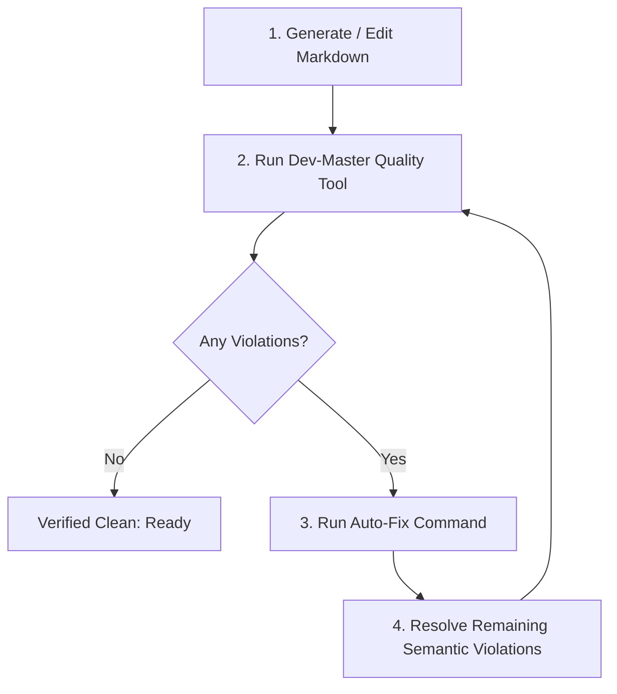

# Markdown Quality & Formatting Engineering

## Overview

High-quality Markdown is clean, semantic, portable across different renderers (GitHub, VS Code, Docusaurus, MkDocs, Pandoc), and 100% free of lint warnings. While Markdown's flexibility is its strength, inconsistencies frequently arise in automated agent outputs—such as missing blank lines around structural elements, code fences without language tags, unapproved HTML, and broken link anchors.

This skill grounds all Markdown authoring and review in the official [DavidAnson/markdownlint](https://github.com/DavidAnson/markdownlint) specification (v0.41+), covering all 60 core rules, tag taxonomies, auto-fix mechanics, configuration hierarchy, and an **Automated Self-Correction Loop**.

---

## When to Use

- **Authoring**: When generating any new Markdown (`.md`) file, specification, README, or documentation article.
- **Refactoring & Clean-Up**: When reviewing, formatting, or cleaning up existing Markdown files.
- **Quality Gates & CI**: When setting up linters, formatters, pre-commit checks, or resolving VS Code warnings.
- **Troubleshooting**: When diagnosing warnings like `MD022`, `MD031`, `MD032`, `MD033`, `MD040`, `MD051`, or `MD056`.

---

## The Two Classes of Rules: Mechanical vs. Semantic

Understanding the distinction between mechanical and semantic rules is critical for effective authoring and remediation:

### 1. Mechanical Rules (Automatically Fixable by Linters)

There are **31 auto-fixable rules** in markdownlint. The linter CLI (`markdownlint-cli2 --fix`) or VS Code's `editor.action.formatDocument` can resolve these in under a second:

- **Whitespace & Spacing**: `MD009` (trailing spaces), `MD010` (hard tabs), `MD012` (multiple consecutive blank lines), `MD027` (spaces after `>`), `MD037` (spaces in emphasis `* text *`), `MD038` (spaces in code spans `` ` code ` ``), `MD039` (spaces in link text `[ link ]`), `MD047` (file ends without newline).
- **Block Spacing**: `MD022` (blank line before/after heading), `MD031` (blank line before/after code fence), `MD032` (blank line before/after list), `MD058` (blank line before/after table).
- **Heading Formatting**: `MD018`/`MD019` (spacing after atx `#`), `MD020`/`MD021` (spaces in closed atx `### title ###`), `MD023` (heading must start at column 1), `MD026` (trailing punctuation in headings `## Title:`).
- **List & Table Style**: `MD004` (ul style consistency `-` vs `*`), `MD005`/`MD007` (list indentation), `MD030` (spaces after list marker), `MD044` (proper name casing).
- **Links & References**: `MD011` (reversed link syntax `(text)[url]`), `MD034` (bare URL auto-wrapped in `<>`), `MD049`/`MD050` (emphasis/bold style consistency `*` vs `_`), `MD051` (link fragment casing), `MD053` (unused definitions), `MD054` (link/image reference style).

### 2. Semantic Rules (Must Be Correct During Authoring)

These rules **cannot** be auto-fixed by the linter because they require contextual and authorial intent. The agent must get these right at generation time:

| Rule | Alias | What Triggers It | How to Prevent / Fix |
| :--- | :--- | :--- | :--- |
| **MD001** | `heading-increment` | Skipping levels (e.g. `# Title` $\rightarrow$ `### Section`). | Headings must increment sequentially: `#` $\rightarrow$ `##` $\rightarrow$ `###`. |
| **MD024** | `no-duplicate-heading` | Identical heading text within document. | Make headings unique or configure `"siblings_only": true`. |
| **MD025** | `single-title` / `single-h1` | More than one top-level `# Heading` in a file. | Use `# Title` once at the top; use `##` for major sections. |
| **MD033** | `no-inline-html` | Raw HTML (`<br>`, `<div>`, `<span>`, `font`). | Use standard Markdown line breaks (2 trailing spaces or paragraph breaks). `<br>` is only permissible inside Markdown tables or Mermaid labels if permitted in config. |
| **MD036** | `no-emphasis-as-heading` | Bolding a whole line to simulate a heading (`**Section**`). | Use real headings (`### Section`) instead of bold text. |
| **MD040** | `fenced-code-language` | Fenced block without syntax identifier (` ``` `). | Always specify the language (e.g. ```` ```bash ````, ```` ```text ````, ```` ```json ````, ```` ```arabic ````). |
| **MD042** | `no-empty-links` | Links with empty destinations `[label]()`. | Always provide a valid destination URL or path. |
| **MD045** | `no-alt-text` | Images without alternate text ``. | Provide descriptive alt text ``. |
| **MD051** | `link-fragments` | Internal link fragment `#slug` that matches no heading. | Verify anchor text matches the exact lowercased, hyphenated slug of the heading. |
| **MD056** | `table-column-count` | Rows having different column counts than header. | Ensure every table row has matching delimiter pipes. |
| **MD059** | `descriptive-link-text` | Vague link text like `[click here](...)` or `[link](...)`. | Use descriptive text `[Read the authentication guide](...)`. |

---

## Complete Rule Tag Taxonomy

markdownlint groups related rules by **tags**. You can configure entire groups at once:

- `accessibility`: MD045, MD059
- `atx` & `atx_closed`: MD018, MD019, MD020, MD021
- `blank_lines`: MD012, MD022, MD031, MD032, MD047, MD058
- `blockquote`: MD027, MD028
- `bullet`: MD004, MD005, MD007, MD032
- `code`: MD014, MD031, MD038, MD040, MD046, MD048
- `emphasis`: MD036, MD037, MD049, MD050
- `headings`: MD001, MD003, MD018, MD019, MD020, MD021, MD022, MD023, MD024, MD025, MD026, MD036, MD041, MD043
- `html`: MD033
- `images`: MD045, MD052, MD053, MD054
- `indentation`: MD005, MD007, MD027
- `language`: MD040
- `line_length`: MD013
- `links`: MD011, MD034, MD039, MD042, MD051, MD052, MD053, MD054, MD059
- `table`: MD055, MD056, MD058, MD060
- `whitespace`: MD009, MD010, MD012, MD027, MD028, MD030, MD037, MD038, MD039

---

## Authoring Standards & Templates

### 1. Structural Isolation (The Blank Line Rule)

Every structural block in Markdown must be preceded and followed by an empty line:

````markdown
<!-- CORRECT -->
# Document Title

Introductory paragraph with clean text.

## First Section

Paragraph explaining the context.

- List item 1
- List item 2

```bash
npm run build
```text

| Header A | Header B |
| :--- | :--- |
| Cell 1 | Cell 2 |
````

### 2. Code Block Language Tagging (MD040)

Never emit a bare ```` ``` ```` fence:

- Plain output, directory trees, logs: ```` ```text ```` or ```` ```plain ````
- Scripts and code: ```` ```bash ````, ```` ```powershell ````, ```` ```json ````, ```` ```python ````
- Diagrams: ```` ```mermaid ````
- Specialized scripts: ```` ```arabic ````, ```` ```abap ````, ```` ```sql ````

### 3. Inline HTML & Tables (MD033)

- **Prose**: Never use `` in paragraphs, blockquotes, or lists. Use double space at the end of a line or create a new paragraph.
- **Tables**: Markdown tables do not allow multiline cells with raw newlines. In tables where line wrapping is required, `` is acceptable when permitted in `.markdownlint.json`:

  ```json
  "MD033": {
    "allowed_elements": ["br", "details", "summary", "img", "kbd", "sub", "sup"]
  }
  ```

### 4. Link Anchor Slugging (MD051)

GitHub slugger rules:

1. Convert heading text to lowercase.
2. Remove punctuation: `[^\p{Letter}\p{Mark}\p{Number}\p{Connector_Punctuation}\- ]`.
3. Replace spaces with single hyphens `-`.
4. Collapse duplicate hyphens.
*Example*: `## 1. Step-by-Step Guide!` becomes `#1-step-by-step-guide`.

---

## Inline Suppressions & Exceptions

When deliberate formatting exceptions are necessary, use standard HTML comment annotations:

```markdown
<!-- Disable a specific rule for the next line -->
<!-- markdownlint-disable-next-line MD033 -->
<span>Custom inline element</span>

<!-- Disable multiple rules for a section -->
<!-- markdownlint-disable MD001 MD024 -->
### Non-conforming Subsections
### Non-conforming Subsections
<!-- markdownlint-enable MD001 MD024 -->

<!-- Temporarily disable all rules and restore former state -->
<!-- markdownlint-capture -->
<!-- markdownlint-disable -->
Unchecked legacy content
<!-- markdownlint-restore -->

<!-- Disable rule for entire file (can be placed at bottom of file) -->
<!-- markdownlint-disable-file MD013 -->
```

---

## Configuration Hierarchy & Recommended Setup

Configuration resolution order (highest precedence to lowest):

1. `.markdownlint-cli2.{jsonc,yaml,cjs,mjs}`
2. `.markdownlint.{jsonc,json,yaml,yml,cjs,mjs}`
3. VS Code workspace / user settings
4. Built-in defaults

### Recommended `.markdownlint.json`

```json
{
  "default": true,
  "MD013": false,
  "MD024": { "siblings_only": true },
  "MD028": false,
  "MD029": false,
  "MD033": {
    "allowed_elements": ["br", "details", "summary", "img", "kbd", "sub", "sup"]
  },
  "MD060": false
}
```

### Recommended `.markdownlint-cli2.jsonc`

```jsonc
{
  "config": {
    "default": true,
    "MD013": false,
    "MD024": { "siblings_only": true },
    "MD028": false,
    "MD029": false,
    "MD033": {
      "allowed_elements": ["br", "details", "summary", "img", "kbd", "sub", "sup"]
    },
    "MD060": false
  },
  "ignores": [
    "node_modules",
    ".git",
    "brain",
    ".system_generated"
  ]
}
```

### VS Code Formatting Integration (`.vscode/settings.json`)

```json
{
  "[markdown]": {
    "editor.formatOnSave": true,
    "editor.formatOnPaste": true
  },
  "editor.codeActionsOnSave": {
    "source.fixAll.markdownlint": "explicit"
  }
}
```

---

## The Automated Self-Correction Loop



### Fast Terminal Commands

Run from project root:

```powershell
# Lint check files
node "$env:USERPROFILE\.gemini\config\plugins\dev-master\scripts\markdown-tool.cjs" lint "**/*.md"

# Auto-fix all mechanical issues (31 rules)
node "$env:USERPROFILE\.gemini\config\plugins\dev-master\scripts\markdown-tool.cjs" fix "**/*.md"

# Intelligently clean <br> tags in paragraphs
node "$env:USERPROFILE\.gemini\config\plugins\dev-master\scripts\markdown-tool.cjs" clean-br "**/*.md"

# Auto-tag bare fences with "text" language
node "$env:USERPROFILE\.gemini\config\plugins\dev-master\scripts\markdown-tool.cjs" fix-fences "**/*.md"

# Audit breakdown by rule code
node "$env:USERPROFILE\.gemini\config\plugins\dev-master\scripts\markdown-tool.cjs" audit "**/*.md"
```

*(In CMD: replace `node "$env:USERPROFILE\...cjs"` with `call "%USERPROFILE%\.gemini\config\plugins\dev-master\scripts\check-markdown.cmd"`)*
